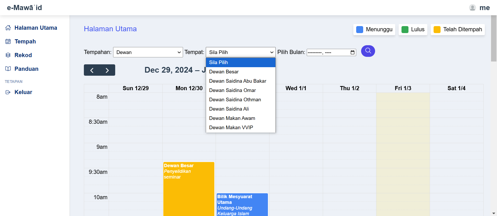
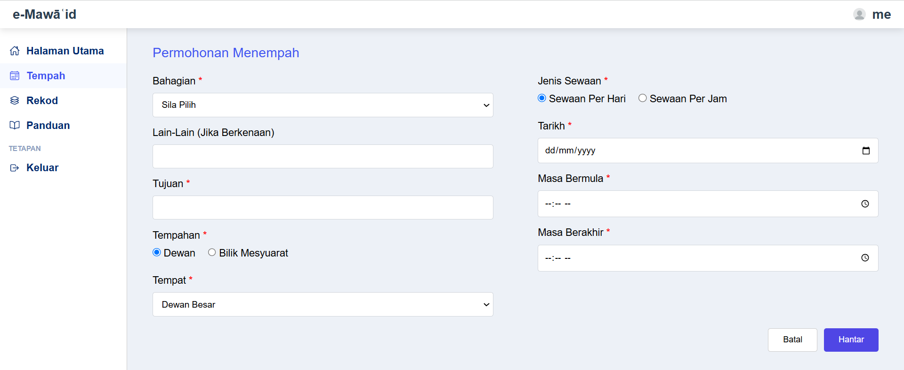
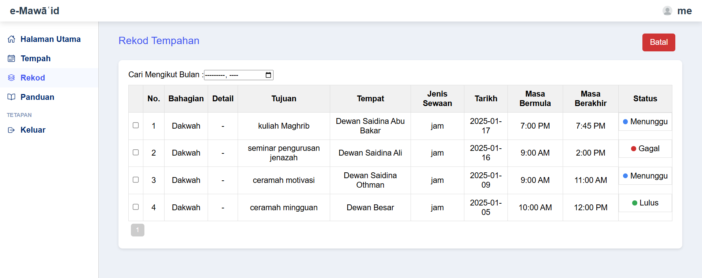
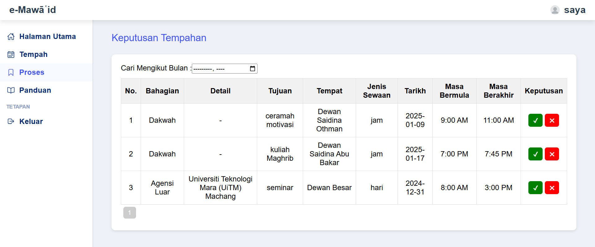

# e-Mawaid: Hall & Room Booking System

e-Mawaid is a web-based booking system for halls (*dewan*) and meeting rooms (*bilik*). Staff submit booking requests online, and an administrator reviews, approves or rejects them. Everyone involved gets an email notification.

Built with **PHP**, **MySQL/MariaDB**, **HTML/CSS/JavaScript** and **PHPMailer**, and runs on **XAMPP**.

## Features

**User**
- Log in with a user account
- Weekly booking calendar that can be filtered by hall/room and month, showing pending, approved and booked slots
- Book a hall or room by day or by hour, with department, purpose, date and time
- View their booking records and status (*menunggu* / *lulus* / *gagal*: pending / approved / rejected)
- Built-in user manual with screenshots

**Admin**
- Separate admin dashboard (role-based login)
- Review pending bookings and approve or reject them
- Make bookings on behalf of users
- Admin manual with screenshots

**System**
- Email notification to admins when a new booking is made (Gmail SMTP via PHPMailer)
- Prepared statements on login to prevent SQL injection
- Session-based access control, with session ID regeneration on login

## Pages

| File | Purpose |
|---|---|
| `login.php` | Login for users and admins |
| `Halaman Utama.php` | User home page |
| `Tempahan.php` | User booking form |
| `Rekod.php` | User booking records |
| `Manual.php` | User manual |
| `Admin Home.php` | Admin dashboard |
| `Admin Tempah.php` | Admin booking form |
| `Admin Proses.php` | Approve / reject bookings |
| `Admin Manual.php` | Admin manual |
| `mail.php` | Email sending helper (PHPMailer) |
| `e-tempahan.sql` | Database schema and demo accounts |

## Running it locally

1. Install [XAMPP](https://www.apachefriends.org/) and start **Apache** and **MySQL**.
2. Copy this folder into `xampp/htdocs/`.
3. Open phpMyAdmin, create a database named **`e-tempahan`**, and import `e-tempahan.sql`.
4. Copy `config.example.php` to `config.php`, then add a Gmail address, its [app password](https://myaccount.google.com/apppasswords) and the admin email(s).
5. Go to `http://localhost/e-mawaid.com/login.php`.

Demo accounts:

| Role | Username | Password |
|---|---|---|
| Admin | `admin` | `admin123` |
| User | `user` | `user123` |

## Screenshots

| | |
|---|---|
|  |  |
|  |  |
